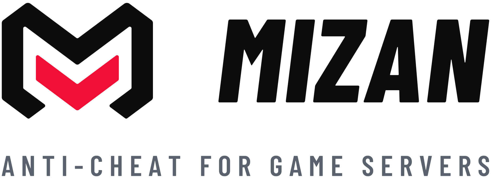

<a href="https://mizan.ac">
  <picture>
    <source media="(prefers-color-scheme: dark)" srcset="assets/hero-dark.svg">
    <source media="(prefers-color-scheme: light)" srcset="assets/hero-light.svg">
    
  </picture>
</a>

 
 

Mizan judges how players aim, move and time their commands on the server. 
Players install nothing, and there is nothing on their computer for a cheat to hide from.

[Website](https://mizan.ac) &nbsp;·&nbsp; [Anti-cheat](https://mizan.ac/anti-cheat) &nbsp;·&nbsp; [Comparison](https://mizan.ac/anti-cheat/compare) &nbsp;·&nbsp; [Blog](https://mizan.ac/blog) &nbsp;·&nbsp; [Discord](https://discord.gg/fRbk43tKcV)

 

**Garry's Mod** &nbsp;·&nbsp; early access &nbsp;·&nbsp; [MizanAC/gmod-anticheat](https://github.com/MizanAC/gmod-anticheat) 
Planned: Rust, Counter-Strike 2, FiveM, Counter-Strike: Global Offensive and Minecraft

 

<a href="mailto:contact@mizan.ac">contact@mizan.ac</a> &nbsp;·&nbsp; <a href="https://mizan.ac/security">Security policy</a> &nbsp;·&nbsp; KORDU LTD

